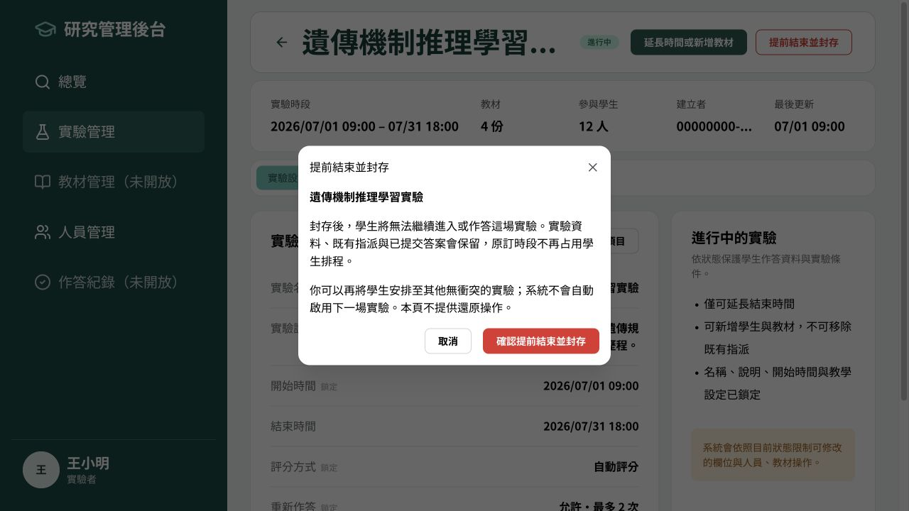
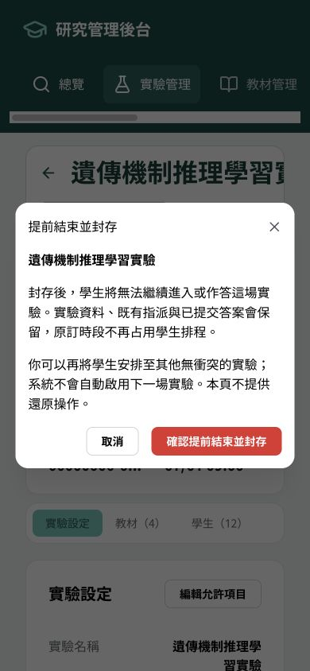
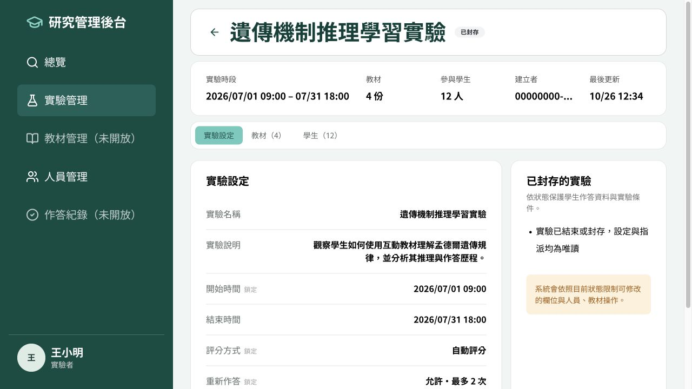
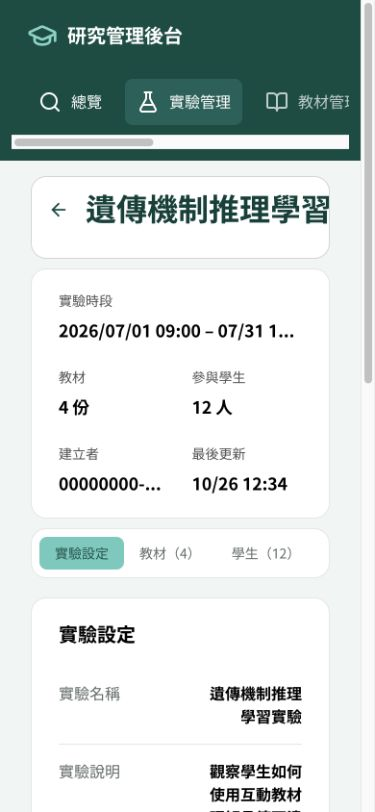

# 實驗提前結束與取消封存驗證

日期：2026-10-26（Asia/Taipei）。frontend 分支 `feat/experiment-termination`，基底 `main`：`75614b6c4d4c3c52f58ba727832ef9529d70386d`。獨立於 PR #61，由 Eason review、手動 merge。

## 變更

| 原狀態           | 操作           | API 結果       |
| ---------------- | -------------- | -------------- |
| DRAFT／SCHEDULED | 取消並封存     | ARCHIVED       |
| ACTIVE           | 提前結束並封存 | ARCHIVED       |
| COMPLETED        | 封存實驗       | ARCHIVED       |
| ARCHIVED         | 唯讀           | 不提供封存操作 |

沿用 `PUT /api/experiments/{id}/status`、`{"status":"ARCHIVED"}`，保留資料與原訂時段。確認視窗顯示實驗名稱與後果。成功時以回傳資料更新詳細頁，背景刷新管理與 Current Experiment 快取。每次封存與結果查核請求限時 15 秒。

4xx 顯示拒絕原因並重新讀取最新狀態，不視為本次操作成功。網路／逾時／5xx 結果不明時先 GET 查核；已封存則確認成功，未封存才開放手動重試。GET 也失敗時，只開放重新查核，不自動重送 PUT。重試會再次經過確認按鈕。

只修改 frontend；未變更 API spec、backend、LLM、部署設定或 PR #61。沒有刪除或自動啟用下一場實驗，其他裝置需重新查詢／重新整理才會更新畫面。

## 驗證結果

| 項目                                     | 結果     | 證據／限制                                                                             |
| ---------------------------------------- | -------- | -------------------------------------------------------------------------------------- |
| 前端測試                                 | PASS     | 32 files、147 tests；含狀態入口、取消、重複操作、錯誤查核、快取、Demo 無網路           |
| TypeScript／ESLint／Prettier             | PASS     | `pnpm typecheck`、`pnpm lint`、`pnpm format`                                           |
| Production build                         | PASS     | 使用 Dev URL 及 `VITE_APP_MODE=dev`；原有大 bundle 提示仍存在                          |
| 桌面、390 × 844 手機確認及唯讀畫面       | PASS     | 本機 Admin Demo；截圖如下，並非 Dev 真實資料                                           |
| ACTIVE 封存後解除 409、學生轉場          | PASS     | 真實本機後端與 HttpOnly session，見 `local-api.json`                                   |
| DRAFT／SCHEDULED／COMPLETED 封存釋放時段 | PASS     | 每一狀態各建立兩場重疊實驗驗證                                                         |
| 保留舊時段、設定、學生／教材指派及答案   | PASS     | 封存前後 API 讀回比對；學生在轉場前無 Current Experiment 且舊教材存取 403              |
| 學生無權封存                             | PASS     | 真實 API 回傳 403                                                                      |
| Dev／國網部署驗收                        | 尚未驗證 | Dev IAB 登入狀態入口遭 `ERR_BLOCKED_BY_CLIENT`；本輪未操作遠端實驗，須在合併部署後驗收 |

### 本機真實後端的界線

使用既有隔離環境 `sciedu-phase-b`：API `http://localhost:58080`。測試帳號為既有專用 Phase B 管理者與學生甲，透過既有 session 工具續發本機 session；沒有新增公開登入 API，也沒有重建資料庫。

執行中容器的 image ID：`sha256:c80d82ba9b8c25bde821ee37ec67c8c2ed8b88f54eae461568939937feb78dc3`；`/app/backend` SHA-256：`2ff480fcc96369aa56114161ce490a6040a2d5466ea853f9105e9100ad9d3c06`。這是本機既有 binary 的驗收，不代表 Dev／國網部署版本已驗收。

另外只讀核對 backend main `b6e8bcb62e7d6e4041a9bd13eb5ff4fc71452227`：支援 ACTIVE 直接封存，衝突查詢只排除 ARCHIVED，並已有相同轉場情境的整合測試。此 PR 未改動或重新執行整套後端測試。

驗收工具每次產生唯一 `ARCHIVE-QA-*` 名稱，僅封存此次建立的實驗，不刪資料、不改既有實驗。第一輪因答案列表缺少 `experimentId` 收到 400，修正工具後完整通過；原始紀錄保留於 `local-api-initial.json`。兩輪建立的測試實驗均已封存；本機 QA 教材及答案保留供檢視。

### 重現

前端：

```sh
pnpm install --frozen-lockfile
pnpm test
pnpm typecheck
pnpm lint
pnpm format
VITE_APP_MODE=dev VITE_BACKEND_BASE_URL=https://dev.sciedu.sdc.nycu.club pnpm build
VITE_ADMIN_DEMO_MODE=true VITE_APP_MODE=dev pnpm dev --host 127.0.0.1 --port 5195 --strictPort
```

Demo 畫面：`http://127.0.0.1:5195/admin/experiments`。Demo 狀態只保存在記憶體，整頁重新載入會重置。

真實本機 API（使用有效的既有測試 session JSON；不要把 session 檔案提交進 Git）：

```sh
python3 tools/experiment-termination/verify_local.py \
  --api-base http://localhost:58080 \
  --admin-session /path/to/private/admin.json \
  --student-session /path/to/private/student-a.json \
  --student-id a0000000-0000-4000-8000-000000000002 \
  --output /tmp/archive-acceptance.json
```

工具限制本機 Phase B API，不接受遠端網址。若專用學生已有目前實驗，先停止驗收，不會封存既有實驗。證據排除 cookie、認證標頭與 session 回應。

## 畫面






## 合併順序

1. Review 此 PR 與 CI，手動合併到 main 並部署。
2. 使用專用測試實驗重驗封存、解除指派衝突與學生轉場。
3. 將已合併 main 同步到 #61，解衝突並重跑教材／Chat 回歸測試。

本輪不合併 PR、不將未合併的分支直接帶進 #61。
